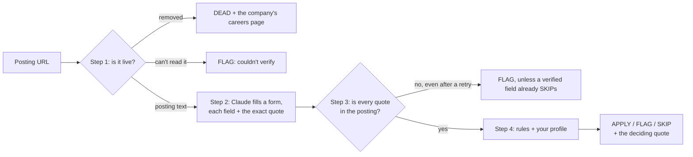
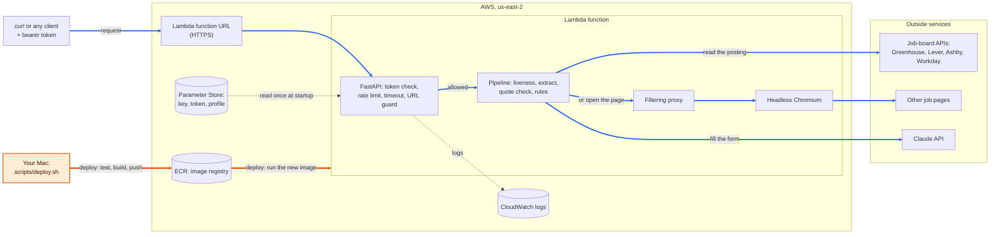

<h1 align="center">posting-triage</h1>

<p align="center">
  <b>The LLM reads · code decides</b>
</p>

<p align="center">
  <a href="https://github.com/jar-narvz/posting-triage/actions/workflows/test.yml"></a>
  <a href="https://github.com/jar-narvz/posting-triage/actions/workflows/docker.yml"></a>
  <a href="LICENSE"></a>
  
</p>

<p align="center">
  <a href="docs/design.md">Design doc</a> · <a href="docs/deploy.md">Deploy guide</a> · <a href="docs/labeling-guide.md">Labeling guide</a>
</p>

Reads a job posting and answers **APPLY**, **FLAG**, **SKIP**, or **DEAD**, with a one-line reason quoted from the posting itself.

An LLM reads the posting and fills in a form, every answer backed by the posting's exact words; plain code checks those words are really there and makes the decision. It runs as a command-line tool and as a REST API deployed on AWS Lambda.



## Quick Start

### 1. Install

You need Python 3.11 or newer.

```bash
git clone https://github.com/jar-narvz/posting-triage.git
cd posting-triage
python3 -m venv .venv
source .venv/bin/activate
pip install -e .
playwright install chromium   # only needed for pages that aren't on a job board's API
```

### 2. Add your profile and API key

```bash
triage init            # asks a few questions and writes profile.yaml
cp .env.example .env   # then set ANTHROPIC_API_KEY in .env
```

`profile.yaml` holds your degree, graduation date, locations, tracks, and the role types you want and don't want ([example](profile.example.yaml)). It's gitignored. You need an [Anthropic API key](https://console.anthropic.com/).

### 3. Triage a posting

```bash
triage run <posting-url> [<posting-url> ...]
triage run --json <posting-url>                  # one JSON object per posting
triage run --model claude-sonnet-5-5 <posting-url>
```

With the default model (Haiku) a posting costs well under a cent: the whole 205-posting eval run cost $0.05 at batch price, which is half the normal price.

<details>
<summary><b>Run it with Docker, or as a local API</b> (click to expand)</summary>

One image runs both the command line and the API:

```bash
docker build -t posting-triage .
docker run --rm --env-file .env -v "$PWD/profile.yaml:/app/profile.yaml:ro" posting-triage triage run <posting-url>
```

The first build downloads Playwright's base image (about 3.5 GB). More in the [deploy guide](docs/deploy.md).

To run the API locally, set `TRIAGE_API_TOKEN` in `.env` (`.env.example` shows how to make one), then start the server:

```bash
triage serve           # http://127.0.0.1:8000, interactive docs at /docs
```

and call it from a second terminal, in the same folder:

```bash
TOKEN=$(grep ^TRIAGE_API_TOKEN= .env | cut -d= -f2)
curl -X POST http://127.0.0.1:8000/triage \
  -H "Authorization: Bearer $TOKEN" \
  -H "Content-Type: application/json" \
  -d '{"url": "<posting-url>"}'
```

</details>

## See the Result

Real results from Oct 26, 2026 (long Workday URLs shortened with `…`):

```text
$ triage run <GM posting> <TikTok posting> <S&P Global posting>

FLAG   https://generalmotors.wd5.myworkdayjobs.com/…/2027-Summer-Intern---Machine-Learning-Engineer--AV-AI-Platform_JR-202621695
       graduation: "Must be graduating between December 2027 and August 2029"
APPLY  https://lifeattiktok.com/search/7668701361741007109
FLAG   https://spgi.wd5.myworkdayjobs.com/…/Software-Engineer---Summer-Intern-2027_331717-2
       couldn't verify (no posting text)
```

- **FLAG on graduation:** the applicant graduates in May 2027, outside the posting's window, so a person should decide. The reason is the posting's own sentence, not a paraphrase.
- **APPLY:** every rule passed.
- **FLAG, couldn't verify:** this is the deployed API on AWS Lambda, where this company's job pages render empty. When the tool can't read a posting, it says so instead of guessing.

## Why posting-triage

Applying to a posting that was never a fit costs a tailored resume, sometimes a cover letter, and the application, then often an automatic rejection. Filtering by hand or by keyword falls short in three ways:

- **Keywords miss the fields that matter.** Role level, degree, years of experience, graduation window, and location are written in sentences, not titles. "2+ years preferred" is sometimes a real cutoff and sometimes not.
- **Dead links waste time.** A closed posting can hide a careers page with other roles worth applying to.
- **An LLM's verdict alone can't be checked.** Asked "should I apply?", a model gives an answer and a reason in its own words, with no way to tell a real reason from an invented one.

So the LLM only reads: it fills a form with the posting's exact words, code checks each quote is really in the posting, and deterministic rules compare the fields with your profile. Every answer can be traced back to a sentence in the posting.

## Results

Full eval run, Oct 24, 2026: 200 synthetic postings (seed 2027) through the Batch API.

| Approach | Apply precision | Apply recall | Accuracy | Right reason | Cost |
|---|---|---|---|---|---|
| Keyword baseline (no LLM) | 54/98 = 55% | 54/70 = 77% | 111/200 = 56% | – | $0 |
| Direct prompt · Haiku 5.5 | 70/70 = 100% | 70/70 = 100% | 199/200 = 99.5% | 199/200 = 99.5% | $0.03 |
| **Pipeline · Haiku 5.5** | **70/70 = 100%** | **70/70 = 100%** | **200/200 = 100%** | **200/200 = 100%** | **$0.05** |
| Direct prompt · Sonnet 5.5 | 67/70 = 96% | 67/70 = 96% | 188/200 = 94% | 187/200 = 94% | $0.17 |
| Pipeline · Sonnet 5.5 | 70/70 = 100% | 70/70 = 100% | 200/200 = 100% | 200/200 = 100% | $0.44 |
| Direct prompt · Opus 5.5 | 70/70 = 100% | 70/70 = 100% | 200/200 = 100% | 200/200 = 100% | $0.62 |
| Pipeline · Opus 5.5 | 70/70 = 100% | 70/70 = 100% | 200/200 = 100% | 200/200 = 100% | $0.97 |

*Apply precision:* of the postings an approach said to apply to, how many it should have. *Right reason:* the verdict and the deciding field are both right. *Direct prompt:* the LLM gives the verdict itself, built only as a comparison. *Cost:* the whole run, 200 synthetic plus 5 real postings, at batch price.

**What it shows**

- **Any LLM approach beats keyword rules:** 56% → 94–100% accuracy. Keyword rules have no FLAG at all: every posting that needed a human look was wrongly answered APPLY or SKIP.
- **The pipeline scored 100% on every model; the direct prompt's accuracy depended on the model** (94–100%). Most of Sonnet's direct misses broke a decision rule rather than misreading the posting: five times it FLAGged an ambiguous role type when another rule had already SKIPped. In the pipeline, "any SKIP beats any FLAG" is code, so that mistake can't happen.
- **Haiku is the default model.** It ties the best score for about 1/20 the cost of Opus (the rule: the cheapest model within 5 points of the best apply precision).

**How far to trust it**

- **The synthetic scores are an upper bound.** Postings are generated from a target verdict, a deciding field, and a hand-reviewed phrase library, so the right answers are known by construction, not computed by the rules being tested. The benchmark is near its ceiling: it shows the approaches tie at the top, not by how much the pipeline would win on messier text.
- **Only 5 real postings are hand-labeled so far.** Every LLM approach got all 5 verdicts right, and the baseline got 3. All 5 are SKIPs, so they can't measure apply precision, and 5 is too few to rank approaches.

## Architecture



**How to read it:** thick blue arrows are **a request** (every call, left to right); orange arrows are **a deploy** (only when you ship a new version, never during a request); dotted arrows happen once at startup or in the background.

- **One pipeline, two front doors.** The diagram shows the deployed API. The command line runs the same `triage()` function on your own machine, and both return the same JSON schema; the API adds only access control.
- **One Docker image** runs both, as a non-root user. On Lambda, the Lambda Web Adapter turns each request into an ordinary HTTP call to the server, so the image runs there unchanged.
- **Deploys** run from a Mac with `scripts/deploy.sh`: tests, an arm64 build, a smoke test, a push to ECR, and an update pinned to the image's digest, then a health check. ([Why not GitHub Actions](docs/deploy.md#the-deployed-api-deployed-from-a-mac).)

### The deployed API

It runs privately; a live demo is available on request.

| Endpoint | What it does |
|---|---|
| `GET /health` | `{"status": "ok", "version": "…"}`, no token needed |
| `POST /triage` | Body `{"url": "…", "model": "…"}` (model optional). Needs `Authorization: Bearer <token>` |

```bash
curl -X POST https://<function-url>/triage \
  -H "Authorization: Bearer $TOKEN" \
  -H "Content-Type: application/json" \
  -d '{"url": "https://generalmotors.wd5.myworkdayjobs.com/…"}'
```

```json
{
  "url": "https://generalmotors.wd5.myworkdayjobs.com/…",
  "verdict": "flag",
  "deciding_field": "graduation",
  "quote": "Must be graduating between December 2027 and August 2029",
  "careers_page": null,
  "detail": "",
  "model": "claude-haiku-5-5",
  "latency_ms": 6934
}
```

Errors: 401 missing or wrong token, 429 rate limit (with `Retry-After`), 400 a blocked URL or unknown model, 502 the Claude API failed, 504 too slow. The first request after a quiet spell starts a new copy of the function (about 16 s), and the first posting that copy reads in Chromium takes about 30 s; after that, a triage takes about 3–11 s.

## Safety & Boundaries

- **It never guesses.** A page it can't read is FLAG ("couldn't verify"), never a wrong DEAD. Some companies refuse Workday's API (7 of 51 cached Workday postings); those fall back to the browser, which reads them locally, but on Lambda Workday's pages render empty, so they come back FLAG.
- **Every reason is checkable.** Each field carries the posting's exact words, and code confirms they appear in the text. A quote that isn't there can't decide anything.
- **Live LLM calls are private.** `POST /triage` needs a bearer token, compared in constant time, and the server won't start without one. Each token gets 10 requests a minute, a request gives up after 90 s, and at most 2 run at once.
- **It only fetches the public web.** URLs must be http(s) on ports 80/443 and resolve only to public addresses, so a caller can't make it reach `localhost`, a private network, or the cloud metadata address. Every connection Chromium makes goes through a filtering proxy that applies the same check to redirects, iframes, and page resources.
- **No secrets in the image or the function's settings.** The Anthropic key, the API token, and the profile are encrypted in Parameter Store, read at startup by a role that can read only those three and write its own logs.
- **No stored AWS keys.** Deploys use temporary `aws login` credentials, never a long-lived key.
- **A patched image.** Chromium's unused media libraries are removed: the registry's vulnerability scan went from 337 findings to 0.

## Documentation

- [Design doc](docs/design.md): the problem, requirements, and the 11 design decisions with their reasons and alternatives.
- [Deploy guide](docs/deploy.md): Docker, every AWS resource with its creation and teardown command, deploying, rollback, and measurements.
- [Labeling guide](docs/labeling-guide.md): how real postings are hand-labeled, and the order the rules apply in.
- **Tests:** `pytest` runs 1,485 unit tests (no network, no API calls); `pytest -m browser` runs 6 with real headless Chromium; `scripts/docker_smoke.sh posting-triage` runs 10 checks on a built image. GitHub Actions runs the unit tests on Python 3.11 and 3.13, and builds and smoke-tests the arm64 image, on every push.
- **Reproducing the eval:** `python eval/run_eval.py` re-scores a saved run with no API calls; on a fresh checkout, run `triage cache`, then `python eval/run_eval.py --submit` (about $2.30 for all six LLM runs through the Batch API). Raw responses and posting text aren't committed, because they quote real postings.

## License

MIT. See [LICENSE](LICENSE).
